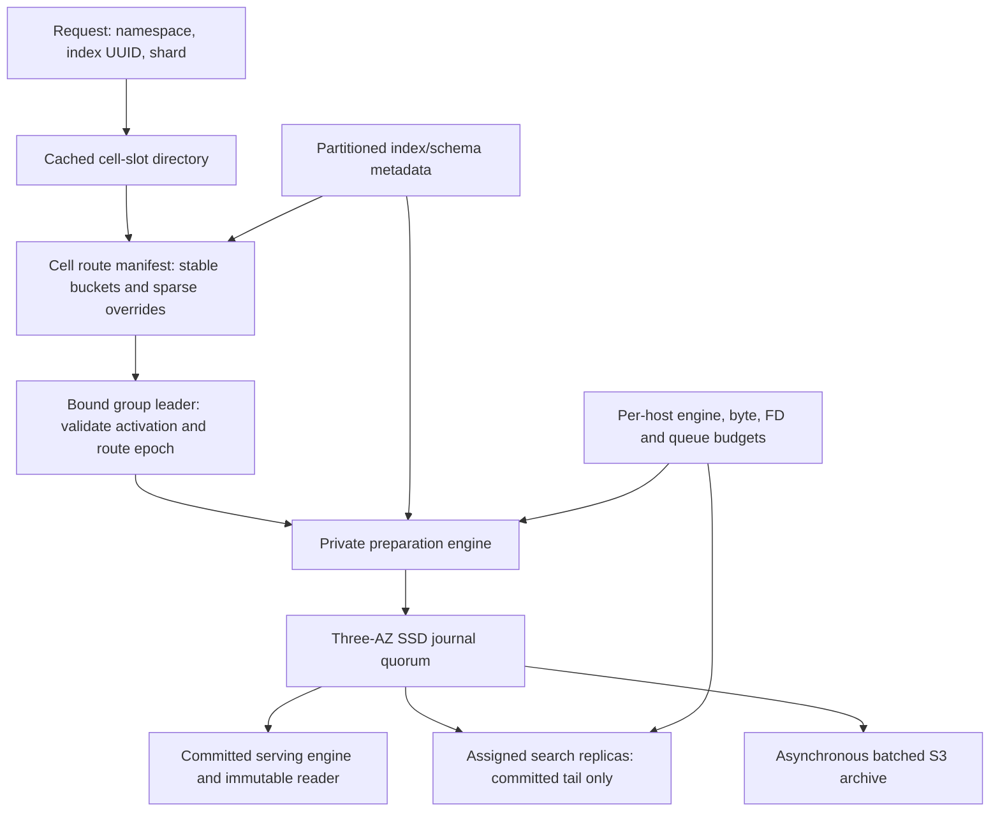

# Cell routing and bounded active state

Status: selected M3a prototype design. Runtime changes are still required alongside
M4; this ADR does not enable quorum-mode index writes or claim million-shard capacity.
Evidence and runnable sources: [capacity experiments](benchmarks/capacity/README.md).
The existing journal durability and membership contracts remain in force.

## Decision

Represent cold logical shards through index UUID, shard number and versioned
routing metadata. A cold descriptor must not allocate an engine, thread, socket,
future chain or periodic task. Store index mappings once per index/schema revision,
not once per shard. Keep a compact, bounded registry of resident shard work and
schedule that registry; do not traverse the deployment's descriptor population
on admission, progress notification, failure or idle eviction.

Partition the deployment into cells with independently recoverable metadata,
journal groups, admission and recovery work. A cell contains bounded physical
journal groups carrying many logical streams. Journal followers persist opaque
operations; they do not each require a Lucene engine for every stream. The leader
needs private preparation and committed serving engines for resident writer shards.
Search hosts independently activate only their assigned shards.

Use 65,536 stable virtual buckets per cell. A versioned immutable bucket map binds
each bucket to a physical group. A sparse, byte/count-bounded override map handles
hot shards. Changing the physical group count never changes an existing live
hash-modulo mapping implicitly. Group movement requires the fenced handoff in M9a.

A small deployment directory maps stable cell slots to cell UUIDs and routing
manifest generations. It changes during cell placement/expansion, not per document.
Route logical keys from deployment/tenant namespace, index UUID and shard number;
retain OpenSearch's existing document-to-shard routing inside that identity.
Names remain labels, and cached directory entries remain hints. The destination
checks the activation and route epoch before accepting mutations or fresh reads.

## Prototype profiles

The first small prototype uses 16 groups and 12 journal hosts per cell, spread
across three AZs. Balanced placement has four local divisions per host. Configure
an explicit eight-division ceiling for this profile: replacing one host within its
AZ can require six divisions on a survivor. This is a design target, not a change
to the library's current default of four or its hard maximum of sixteen.

A denser comparison profile uses 64 groups and 24 journal hosts per cell. It needs
eight divisions normally and ten for balanced same-AZ host repair; its proposed
configured ceiling is twelve. Select it only when measured load/working-set needs
justify the extra divisions. The model rejects 256 groups on twelve or twenty-four
hosts: three replicas require respectively 64 or 32 divisions per host, beyond
the existing hard maximum. Increasing a cell's descriptor count does not authorize
increasing physical divisions or resident engines.

The initial resident-engine design cap is 256 engine units per host. A writer's
preparation plus serving pair consumes two; a search replica consumes one. Reserve
capacity before opening engines, loading mappings or starting catch-up. Also reserve
bytes, FDs, pending operations and cold-start work. A count cap alone is insufficient.
Keep resources charged until failed/retired engines and pinned readers are actually
closed. PIT retention and delayed close cannot bypass these limits.

The capacity model uses a 16-GiB host, a 75% admission envelope and an assumed
32-MiB resident contribution per engine; these are sensitivity inputs, not measured
JVM sizing. Under those inputs, 1M descriptors at 0.1% activity fit the small
one-cell profile at about 10.97 GiB on its busiest leader host. For 10M descriptors
at 0.1%, four dense-profile cells use about 11.40 GiB per busiest host across 96
journal hosts; sixteen small-profile cells use about 8.09 GiB across 192 hosts.
The modeled grid does not fit 10M descriptors at 1% activity within the assumed
host-memory envelope. More memory/cells, smaller measured engine footprints or a
smaller resident working set would be required. These are not product limits or
validated deployment recommendations. These estimates now include bounded peer
RPC message allowances, transient decoding and the additional group/timer workers;
the default four-group peer assignment adds about 617 MiB. Separate preparation
request admission adds another assumed 128 MiB and four 1-MiB worker stacks.
This is conservative model accounting, not a measured gRPC/JVM memory limit.

For comparisons of cell boundaries, hold the fleet constant: the report also
models 384 journal hosts and 1,024 total groups split over 1/4/16 cells. Per-cell
candidate grids intentionally vary total resources and report that difference.

## Required runtime boundaries

Partition index/schema/checkpoint metadata within a cell and use bounded, paged
reads. Cold unmaterialized shards can derive their logical key and route from the
index descriptor; they need not each own a blob or resident Java object. Keep
materialized ownership/history separately. Active-owner indexes support recovery
of a failed host's bounded assignments. Background orphan discovery walks bounded
partitions outside admission. The existing fleet-wide legacy projection/reconciliation
path must not become the new mode's million-descriptor hot path.

Cache metadata by byte weight and count, including retained decoded state. Version
keys prevent a schema or route refresh reusing another generation's value. Single
flight loading needs bounded waiters and cold-activation concurrency, cancellation
that does not cancel accepted persistence, deadlines, and cleanup on every failure.
Broad administrative/search requests also need explicit fanout/response budgets;
exceeding a limit must fail visibly, not return an apparently complete partial result.

Reserve pending proposal bytes/count and submission progress per physical group.
A hot or stalled group must not consume another group's last reserved permit or
all available execution workers. Bound borrowing of spare capacity. Separate
submission, completion, live-tail and bulk-copy budgets. Public callbacks and bulk
recovery must not run under consensus locks. A finite shared pool alone does not
prove group isolation; blocked-lock, stalled-I/O and slow-callback histories must
verify the implementation in M3a/M4a. Actual shared-device/host failures can affect
all groups colocated on that device/host, and AZ loss can pause all groups led there.

The current volume binding fixes its complete original assigned-group set, and
bootstrap/recovery is currently selected for the whole host. Resource headroom in
the model does not authorize adding groups to such a volume. M3a runtime assignment
work must introduce explicit per-group admission and durable lineage checks before
formatting any newly assigned directory, while verifying every existing group
before voting. Unknown directories, changed original transport identities and
stale assignment generations must fail closed. A mixed new/existing-group startup
cannot format established history. Until that protocol passes recovery/race tests,
use fresh authorized hosts for replacement rather than assuming existing free slots
can accept arbitrary new groups.

Every stream carries logical activation, schema and ownership/route generations.
Membership, leader readiness and cached placement are different authorities.
Ownership movement records a committed source cut, archives/pins necessary recovery
data, installs verified target state and fences the old generation before the
routing head can advertise the new one. A late old leader cannot turn a cached
route into permission to acknowledge. No change to document hashing is bundled
into cell movement. Stable operation identity/result retention remains M4a work.

## Failure and transfer policy

Default responses retain synchronous commit semantics. A received request is not
a durable acceptance or a committed outcome. A stream without a reachable quorum
can pause/reject/return an unknown outcome; healthy groups/cells must not acquire
that stream's blocked locks or exhaust its queues. An optional asynchronous inbox
requires a separate durable API and cannot predeclare script/conditional outcomes.

The fluid model keeps healthy groups' service available by construction and models
assumed election pauses; it is not a runtime isolation or election measurement.
A second allocation mode respects finite per-leader-host capacity, exposing the
optimism of assigning a full fleet's service capacity to one group. Publish overload
already present before a failure separately from failure effects, and account for
completed, rejected and outstanding work. More groups do not repair a hot stream
whose offered load exceeds its leader's available capacity.

Keep small committed operations in Raft initially. M6a copies immutable segments
and missing verified chunks directly from peers/S3, with resumable offsets and
separate live versus recovery queues. Connection-wide CPU/NIC/disk budgets and
short fair copy quanta matter even with separate connections. Publish a searchable
checkpoint only after all dependencies verify. No external payload reference may
commit before its own fault-domain-qualified durable copy proof exists.

With three AZs, losing an AZ leaves two voting replicas. Replacing a single host
inside a still-available AZ differs from restoring three-AZ diversity while an AZ
is absent. The latter needs that AZ to return or a separately authorized new fault
domain; spare slots in the two surviving AZs do not satisfy the three-AZ policy.

## Archive and cost gates

The current unpurged journal has a finite retained-position limit. At one operation
per position, the 256-group modeled fleet's 100k-position budget lasts only 25.6
seconds at 1M operations/s. Native metadata can shorten that interval; batching can
extend it. This arithmetic demonstrates why M7 reclamation/recovery must precede
sustained traffic. It is not a tested operation rate or permission to purge.

Archive by physical group with bounded logical-shard metadata, not one tiny upload
per cold descriptor. Flush only dirty groups. Target chunk size and maximum age
both determine request rate; retries, catalogs, compression and segment publication
must be counted separately. Longer buffering reduces request cost but increases
archive age and retained local disk. Preserve the stated one-AZ durability envelope;
all unarchived-replica loss remains outside it.

The cost model exposes assumptions instead of quoting a provider bill. Its example
cross-AZ payload cost exceeds its batched archive PUT cost, and its legacy comparator
already batches writes. Include compute, SSD, queries, GET/LIST/storage and recovery
traffic before making a total-cost claim. HTTP/2/TCP remains the baseline; QUIC and
payload/order disaggregation need their separate measurements and safety gates.

## Implementation exit criteria

This ADR closes the prototype architecture choice, not M3a runtime delivery.
Next integrate bounded active state and explicit per-group assignment with the M4
private-preparation/committed-serving boundary. Verify no speculative operation can
reach readers, publication, PIT, GET or refresh. Then demonstrate per-group admission
and execution isolation under failures, and measure actual engine/mapping/FD/native
memory before freezing capacities. Preserve legacy behavior and the delivered M3
durability proofs throughout. M6a design/prototypes can proceed independently of
production consensus tuning; production claims remain gated by M10.
