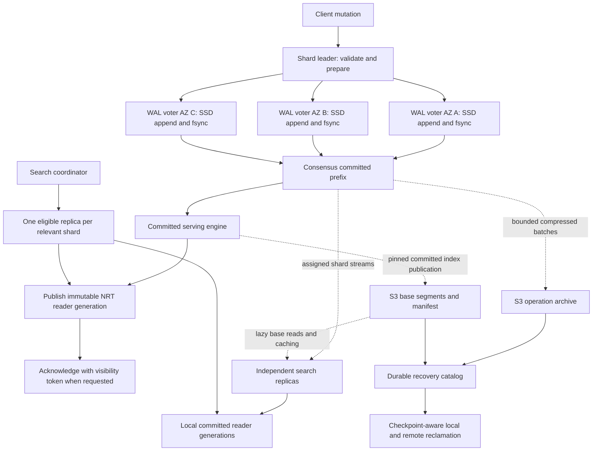

# Low-latency serverless delivery plan

Status: proposed architecture and implementation plan; no runtime changes in this commit.
Branch: `low-latency-serverless`.
Starting point: `a6a174ca121` on `feature/serverlessshell`.
Prepared: 31 October 2026, Australia/Sydney.

## 1. Outcome and boundaries

Deliver an opt-in serverless mode with these properties:

1. Acknowledged mutations survive loss of one node or one AZ, within the stated
   three-AZ failure model, without waiting for an S3 request on each mutation.
2. Fresh searches use immutable Lucene reader generations containing the required
   committed writes. Search capacity scales independently of the number of WAL voters.
3. Recent operations live in replicated, checksummed, SSD-backed logs. Heap buffers,
   local disk occupancy, subscriptions, and concurrent catch-up work have explicit bounds.
4. S3 receives compressed operation batches and immutable index segments asynchronously.
   Published recovery metadata determines when local history can be reclaimed.
5. Placement covers multiple indices and shards. Each search node subscribes only to
   its assigned shards, with capacity limits, tenant isolation, and AZ-aware placement.
6. Preserve OpenSearch routing, document identity, conditional mutation semantics,
   scripts, mappings, query execution, aggregations, PIT behavior, and plugin action filters.
7. Keep the existing S3-authoritative mode usable and unchanged by default. Do not
   create a PR; implementation commits will be reviewed, validated, and pushed here.

This is a staged storage and routing change, not a promise that every workload will
have single-digit millisecond end-to-end latency. Quorum persistence, indexing,
refresh, network distance, query execution, and queueing remain real costs.
HTTP/3 and specialized mutable fields are separate, measured extensions; neither
is a prerequisite for the persistent log and fresh-search release.

## 2. Starting architecture and concrete integration points

Paths below are relative to `serverless/shell/src/main/java/org/opensearch/serverless/`.

| Existing code | Current responsibility | Planned work |
| --- | --- | --- |
| `shell/ServerlessNode.java` | Apply primary operations, append WAL, validate ownership, open readers | Extract mode-specific mutation orchestration; retain action gates and fencing |
| `store/WalGroupCommitter.java` | Bounded, timer-free grouping of concurrent S3 appends | Keep S3 mode; introduce a durable-log abstraction rather than replacing this class globally |
| `store/WalRecord.java` | Resolved document operation and original sequence identity | Versioned envelope with shard incarnation, configuration epoch, operation kind, checksums, and schema dependency |
| `store/WalStore.java` | Object-store operation history and term fencing | Legacy recovery and asynchronous archive backend; separate archive ordinal from consensus log index |
| `engine/ServerlessWriterEngine.java` | Engine recovery from fenced history | Reuse streaming recovery; introduce committed-log replay with explicit identity preservation |
| `engine/ReplaySpool.java` | Bounded-memory recovery validation | Reuse checksumming, streaming, and cleanup patterns |
| `shard/ShardReconciler.java` | Open, recover, flush, publish, release shards | Add committed-serving replicas and checkpoint-aware lifecycle; audit checkpoint assumptions |
| `store/CommitManifest.java`, `store/SegmentPublisher.java` | Immutable segment publication and WAL coverage | Add versioned recovery coordinates and publication fencing |
| `store/BlockCacheDirectory.java`, `store/BlockCache.java` | Lazy S3 base reads and local output/cache | Retain remote base; enforce local-file budgets and safe mmap lifecycle |
| `cluster/ReaderPlacement.java` | Rendezvous hashing as optional cache affinity | Add UUID-aware, capacity-weighted, AZ-aware search assignments; keep affinity distinct from authority |
| `membership/NodeLease.java` | Node discovery, roles, process identity, capacity | Add compatible topology/capability fields; leases never become consensus votes |
| `transport/ShardRouter.java` | Authenticated OpenSearch binary transport forwarding | Carry checkpoint requirements, bounded subscriptions, and mode/configuration epochs |
| `rest/SearchFanout.java` | Multi-index shard fanout, pruning, merge, aggregation reduction | Select eligible replicas and validate freshness at the receiver; audit pruning against recent writes |
| `reconcile/GarbageCollector.java` | Reclaim unreachable remote history | Respect archive, recovery, PIT, snapshot, and migration pins |

The current primary path applies an operation to the engine before appending its
WAL record. The engine assigns `_seq_no`, `_primary_term`, and `_version`. That is
why a simplistic change from `wal.append` to `quorum.append`, followed by refresh,
is unsafe: a refresh can include speculative operations that have not committed.

Current reader placement explicitly permits arbitrary-node fallback because S3 is
the complete authority. In the new mode an arbitrary node must catch up before it
can serve a fresh request. Preserve the current contract for existing S3 mode and
introduce the new eligibility rule explicitly.

The existing publication path also advances the global checkpoint under a
single-authoritative-writer assumption. That calculation must not be reused as a
quorum replication checkpoint without a new proof and tests.

## 3. Target architecture



### 3.1 Identity and authority

- Shard key: deployment/tenant namespace, index UUID, shard number. Index names are
  labels, not unique durable identities. Preserve `OperationRouting.generateShardId`.
- Document identity remains shard-local `_id` plus the existing routing semantics.
- S3 control metadata owns the durable storage-mode/configuration generation.
  Within an activated quorum-mode generation, consensus owns log ordering,
  leadership, and voter membership. Cached placement and node leases are hints.
- A configuration binds a unique group identity, its generation, the shard
  incarnation, and the migration activation nonce. Reusing an index name cannot
  reactivate an old group or token.
- No two independently elected groups may accept writes for the same activation.
  Bootstrap, reconfiguration, and migration must bind both authorities explicitly.
- Existing term-exact checks, UUID checks, transport authentication, and ownership
  fencing remain invariants. An S3 lease expiring must not independently elect a
  competing quorum-mode writer or permit legacy takeover.

### 3.2 Voter placement and consensus selection

Default target: three voters in three AZs, with acknowledgement after a consensus
majority has durably persisted the operation. Disk acknowledgements mean actual
filesystem synchronization, not receipt into a socket, mmap, page cache, or Java buffer.

Evaluate a maintained consensus implementation, with Apache Ratis as an initial
candidate, before adding a dependency. Record license/NOTICE, supported JDK,
transport/security integration, group commit behavior, snapshot installation,
membership changes, failure recovery, and measured per-group overhead. Do not
implement a bespoke Raft protocol or reuse discovery leases as an approximation.

Start with one logical consensus group per active shard for simple correctness,
with many groups multiplexed on shared physical nodes and bounded executors.
Measure group count at 1,000 and 10,000 active shards before production selection.
If overhead is excessive, introduce a separately reviewed shared-log-group design
with per-shard ordered streams, checkpoint vectors, and fair scheduling; that design
is not assumed to be free or equivalent to per-shard groups.

Leader election is not a vote per write. Normal writes append to the elected
leader and share persistence work. Membership changes use the library's safe
reconfiguration protocol, with catch-up before promotion and AZ checks.

### 3.3 SSD and memory model

- Use bounded sequential append buffers and checksummed rotating log files.
  Synchronize file contents and required file/directory metadata before claiming durability.
- mmap is optional for WAL reads, not required for appends. Prefer conventional
  sequential writes unless profiling demonstrates a benefit from mapped writes.
- Use supported Lucene filesystem directories for local output and cache. Validate
  the actual directory selected by OpenSearch on the target JDK/OS; do not assume
  the existing hybrid directory is a raw `MMapDirectory` everywhere.
- Mapped pages and file cache can count against container memory. Budget heap,
  direct buffers, mapped residency, networking, and indexing together. Limit shard
  opens, replay, refresh, and compaction concurrency before increasing heap.
- Separate durable log space from evictable segment cache space, logically or by
  volume/quota. Eviction cannot delete unarchived committed log history.
- Local SSD can disappear with an instance. Three replicas tolerate the specified
  one-AZ failure, not simultaneous loss of all unarchived replicas. State this
  failure envelope in the API and operational documentation.

## 4. Correctness contracts and checkpoints

The following are release invariants, not eventual optimizations.

| Invariant | Required evidence |
| --- | --- |
| No acknowledged mutation disappears after one-AZ loss | Independent client receipt ledger compared with recovered history |
| Only the active consensus leader accepts quorum-mode mutations | Partition and delayed-old-leader histories, including cached S3 heads |
| Search/GET never exposes speculative quorum-mode state | Concurrent refresh, failed persistence, restart, and leader-change tests |
| Original sequence/version identities survive replay | Conditional index/update/delete and replay histories |
| Required freshness is never silently downgraded | Stale route, missing replica, timeout, and partial-result tests |
| One reader generation governs query and fetch | Concurrent field changes, deletes, sorted pagination, aggregation tests |
| S3 manifests describe recoverable committed prefixes | Crash at every upload/catalog/CAS/GC boundary |
| No retained PIT/snapshot loses its dependencies | Compaction, archive deletion, node loss, expiration, and recreation races |
| Existing S3 mode retains its current behavior | Existing complete regression suite and mixed-index queries |

Track these coordinates separately:

1. **Consensus commit coordinate:** group/configuration identity plus log index and
   entry term. Only the library's committed prefix is authoritative.
2. **Shard applied checkpoint:** contiguous committed operations applied to its
   serving engine, with original operation sequence identities.
3. **Searchable checkpoint:** contiguous applied prefix covered by a specific
   pinned Lucene reader generation. Receiving or applying a record is insufficient.
4. **Archive checkpoint:** a contiguous prefix covered by immutable S3 chunks and
   an atomically published recovery catalog, including current group configuration.
5. **Base checkpoint:** exactly the prefix included in a pinned published index commit.
6. **Retention pins:** checkpoints needed by catch-up, PIT, snapshots, migration,
   consensus snapshot installation, and active archive readers.

Never equate maximum observed `_seq_no`, archive object ordinal, or advertised
replica progress with a contiguous safe checkpoint. Out-of-order application,
failed operations, no-op slots, bulk-item failures, and configuration changes need
explicit representation and tests.

Tokens are versioned, bounded, deployment-scoped shard checkpoint vectors, with
index UUID and activation identity. They must survive legitimate leader changes:
an election alone does not invalidate a committed write's token. A receiver can
prove prefix inclusion through durable log history or an installed checkpoint.
Recreated indices, conflicting histories, unauthorized shards, and unsupported
token versions are rejected. Validate size and shard count before allocating or
fanning out; authenticate tokens or verify each claimed coordinate through an
authorized namespace-scoped lookup so forged tokens cannot force unbounded work.

## 5. Mutation and committed-search integration

### 5.1 Resolve the engine preparation boundary first

Prototype two implementations and select using correctness plus measured cost:

**A. Private primary preparation engine plus committed serving engine.** The leader
uses the private engine to perform existing validation, scripts, CAS, sequence and
version assignment. Replicate resolved operations in the same per-shard order.
Only committed records are applied to a separate serving engine. The private
engine never serves GET, search, PIT, stats that imply committed state, or segment
publication. This reuses core behavior but can duplicate indexing and disk work.

**B. Prepare/commit engine integration.** Introduce narrowly scoped upstream-neutral
hooks separating preparation/identity assignment from committed application. This
can avoid duplicate indexing but requires a substantially stronger engine proof.
Do not change core's normal replication or recovery behavior incidentally.

Use A as the correctness prototype, not as an assumed production performance win.
If it misses the CPU/disk gates, implement and review B before general release.
No milestone may simply refresh a primary engine containing uncommitted writes.

### 5.2 Mutation sequence

1. Authorize through the existing action chain. Resolve alias/data-stream target,
   index UUID, mappings/settings version, storage-mode epoch, and document routing.
2. Verify current consensus leadership, incarnation, and backpressure budgets.
3. Prepare the operation using a per-shard ordered sequencer. Resolve scripts once;
   followers replay the resulting operation rather than rerunning scripts or clocks.
4. Append the full versioned operation envelope. Order concurrent submissions before
   allowing their results to depend on each other; preserve that order in the log.
5. Commit through a durable majority. Timeouts can be ambiguous: report that outcome
   and preserve existing conditional retry semantics. Define bounded request-ID
   deduplication for internal retries; do not promise arbitrary client exactly-once retries.
6. Apply the committed prefix to the serving engine using original identities and
   correct replica/recovery hooks. Resolve failed sequence allocations with no-ops
   or fence/rebuild; never advertise a checkpoint across an unresolved gap.
7. GET can return committed applied state. Fresh-search acknowledgement additionally
   waits for a grouped reader refresh covering the operation.
8. Respond with existing OpenSearch operation fields plus an optional freshness token.

On loss of leadership, stop preparation and discard speculative suffix state.
Rebuild the preparation engine from a proven committed checkpoint before accepting
new operations. A serving-engine failure after commit cannot erase the log record;
the client may receive an ambiguous failure and recovery must finish application.
If preparation changed private engine state but append fails before the operation
enters the ordered log, fence and rebuild that engine before admitting another
mutation. Otherwise a later operation could depend on state absent from the log.

Bulk retains per-item outcomes and ordering; it does not become a multi-document
transaction. Test repeated IDs, partial failures, deletes, create, scripts, upsert,
and stale CAS across chunk boundaries. Preserve original `_primary_term` on replay
while allocating a new, monotonic write term for a new leader; document the mapping
between engine terms and consensus/configuration history.

Mapping changes must be durable and available before dependent entries can apply.
Initial release serializes descriptor changes through the mode controller, records
the exact schema version in the log, and blocks conflicting mutation admission.
Followers cannot derive different dynamic mappings independently. S3 unavailability
may permit writes against already installed schemas, while operations requiring new
control metadata fail explicitly. Alias/rollover/delete fencing must cover this window.

## 6. Search semantics and scaling

### 6.1 Consistency modes

Define names and wire encoding in the API milestone; these are proposed contracts:

| Mode | Behavior |
| --- | --- |
| Existing/default compatibility | Preserve current per-index behavior; no new implicit global consistency promise |
| At least token | Each referenced shard uses a reader covering its required committed prefix |
| Current committed | Obtain a current checkpoint through leader/quorum read authority, then wait for a covering reader |
| PIT | Use the original pinned generations; reject an incompatible newer freshness requirement |

A multi-shard checkpoint vector is not a globally atomic snapshot. Explain this
for multi-index searches, aliases, data streams, and rollover. A token referencing
an index outside a query may be ignored only under a documented rule; a token for
a deleted/recreated queried incarnation must not silently match the replacement.

Quorum commit and search visibility remain separate response conditions. Preserve
existing `refresh` behavior in S3 mode. For quorum mode, document `false`, `true`,
and `wait_for` explicitly and supply the opt-in checkpoint contract without
silently adding an every-write refresh to existing clients. Do not wait for every
search replica before acknowledging a mutation.

### 6.2 Replica placement and subscriptions

- Reuse rendezvous hashing for preferred assignment, adding index UUID, AZ/region,
  capacity weights, tenant allocation, and hardware/storage capabilities.
- Preserve `OperationRouting` for document-to-shard mapping. Do not introduce a
  second per-document ring that breaks query routing or creates cross-shard movement.
- Maintain a small directory of shard subscribers: node stable/process IDs, assignment
  generation, serving state, and progress. Advertisements guide routing; the serving
  receiver validates the checkpoint against the actual pinned reader.
- Assign each node only selected shards across selected indices. Share node-level
  connection pools, caches, replication workers, and disk budgets. Never broadcast
  every index update to every search node.
- Search replica count is independent of WAL voter count. Prefer AZ-local eligible
  readers for queries; preserve voter AZ spread independently. Make the locality
  preference soft so failures do not strand an otherwise satisfiable fresh request.
- Use `UNASSIGNED -> BASE_LOADING -> CATCHING_UP -> SERVING -> DRAINING -> CLOSED`.
  Only advertise SERVING after verified base/tail continuity and an opened reader.
- New replicas pin an exact base and replay from its checkpoint. Subscribe before
  the archive/log retention point can advance past them, or restart from a newer base.
- Rebalance by warming the replacement, advertising it, then draining the old copy.
  A placement change is not permission to delete durable log history.
- Hysteresis, cooldowns, tenant quotas, and bounded concurrent opens prevent cold-cache
  storms and hot-shard oscillation. Overload responses are explicit and retry-budgeted.
- Zero hot replicas is allowed only when no recent tail requires them, or when the
  contract accepts cold-start latency. Durable voters cannot scale to zero while
  unarchived committed data exists. A closed activation needs a safe restart protocol.

### 6.3 Query execution

1. Resolve concrete index UUIDs, authorized routing, and relevant shards as today.
2. Validate token cardinality, storage modes, schema dependencies, and PIT compatibility.
3. Choose one eligible replica per shard using cached placement/progress hints.
4. Receiver pins a reader covering the checkpoint and uses it for query and fetch.
5. If behind, choose bounded catch-up, another replica, or a writer-serving fallback.
   That fallback must be the committed serving view, never the speculative engine.
6. Merge standard shard results and reduce aggregations through existing core paths.
7. Return freshness failures distinctly from empty results. A strict freshness request
   defaults to no partial success; explicitly requested partial results identify failed
   shards and cannot claim complete coverage of the token.

Audit pruning digests, routing rollups, request caches, query caches, and negative
lookups. A digest from an old S3 base cannot exclude matches introduced in the tail.
Until a provably covering digest exists, disable that pruning optimization for the
affected shard. Cached results are keyed by the pinned view and cannot bypass the
freshness barrier. Cancellation releases readers, catch-up work, and retention pins.

Use native Lucene document replacement/deletion semantics for release one. A serving
engine opens the base and applies committed tail operations as one logical index;
there is no independent top-K merge of base and delta indexes. That avoids introducing
a second document-version/filter/aggregation implementation in the initial release.

### 6.4 Subscription protocol

Use authenticated, namespace-scoped, bounded streaming frames with shard identity,
activation/configuration version, resume coordinate, checksums, sequence ranges,
credits, and schema version. A subscriber applies only committed entries.

Specify reconnect/deduplication, gaps, truncation, snapshot-required responses,
heartbeat timeouts, cancellation, and maximum frame/decompressed size. A slow search
subscriber cannot stall quorum commit or cause unlimited leader heap/log retention.
If it exceeds its lag budget, drop the subscription and require base-plus-tail resync.
Catch-up fans out from available committed log holders, with per-node and per-tenant
egress limits. Avoid concentrating every search replica's catch-up traffic on the leader.

## 7. S3 archive, publication, retention, and recovery

### 7.1 Archive protocol

Batch committed entries by byte limit and maximum age; start experiments with
8/32/64 MiB chunks and 100 ms/1 s/5 s age caps, not production defaults. Sparse shards
still obey an age bound. Compression and upload concurrency are bounded. Include
schema/configuration records, not just document sources, in the recoverable history.

1. Pin a committed interval and its configuration lineage.
2. Serialize a versioned, checksummed immutable chunk under a unique group/activation key.
3. Upload with bounded retry and idempotent identity. Verify object length/checksum.
4. Publish an immutable catalog generation and CAS its discoverable head, proving
   continuity from the previous catalog. Out-of-order uploads cannot advance across gaps.
5. Mark only the catalog-covered prefix archived. Unreferenced uploads are orphans,
   not recovery authority, and are reclaimed after a safe grace/pin check.

Segment publication pins a committed serving-engine index commit and records exact
base coordinates, mappings/settings identity, file lengths/checksums, and activation.
Readers combine only compatible base/catalog/tail generations. Existing manifest
fields remain readable; a new mode requires capability checks and cannot be served
by an old binary that interprets only `walOrdinal`.

### 7.2 Retention rules

Treat application history retention separately from consensus-library WAL compaction.
Consensus snapshots may compact entries only after a durable, installable snapshot
contains the state needed to recover the group and shard identities. Every permitted
truncation must leave a complete recovery path for a newly elected leader.

Local application history can be reclaimed when it is durably archived or subsumed
by a verified base, and no required consumer/pin still depends on that local copy.
Lagging optional search replicas may be forced to resnapshot rather than pin history
forever. Remote archived history can be deleted only when every retained base,
snapshot, PIT, migration, and recovery checkpoint remains reconstructible without it.
Never infer deletion safety solely from the newest manifest or from upload success.

Retained PITs may require materializing their committed tail into immutable S3
artifacts before they become independently recoverable. Initial implementation must
either complete that materialization or explicitly retain/fail the dependency; it
cannot claim existing deployment-wide PIT durability using only a local reader ref.
Snapshot capture similarly needs a complete archived recovery cut before success.

### 7.3 Failure behavior

| Event | Required behavior |
| --- | --- |
| Process crash / torn local append | Checksum and length validation; discard uncommitted torn suffix; recover committed prefix |
| Leader or one AZ lost | Elect from safe durable history; rebuild serving state; serve tokens only after catch-up |
| Minority isolated | Refuse new commits and current-committed reads; never promote via S3 lease fallback |
| Search replica lost | Route elsewhere; replacement loads base and catches up |
| S3 unavailable | Continue eligible schema-stable writes within local retention budgets; throttle before exhaustion |
| Local disk watermark reached | Evict eligible cache, then throttle/reject writes; never drop unarchived committed data |
| Every unarchived voter disk lost | Recent committed tail may be lost; fail visibly and require operator recovery, not silent stale promotion |
| Catalog or base checksum invalid | Refuse affected recovery; preserve evidence and seek a valid redundant source |
| Entire shard idle | Archive, publish recovery cut, close activation safely, then release eligible compute |

Cold recovery uses a published base plus contiguous catalog history, then committed
live-group suffix if one exists. S3-only disaster recovery cannot recover an unarchived
tail; the tooling reports the last recoverable checkpoint and obtains an explicit
new activation after a catastrophic loss. It must not resurrect an old fenced group.

## 8. Network optimization and HTTP/3 decision

The existing shard path uses OpenSearch `TransportService` and Netty binary transport,
not HTTP. The S3 path uses the repository plugin. Separate these experiments:

| Traffic | Initial implementation | HTTP/3 consideration |
| --- | --- | --- |
| Client REST | Existing supported endpoint; optional external H3-terminating proxy | Useful experiment for lossy/distant clients; does not convert internal transport |
| Coordinator-to-search node | Persistent authenticated binary TCP transport | No wholesale protocol rewrite in release one |
| Consensus replication | Selected library's supported transport and security | Library capability, latency, and CPU determine feasibility |
| Committed-tail subscriptions | Bounded persistent transport with flow control | Optional QUIC experiment behind an interface after TCP baseline |
| S3 requests | Supported SDK/backend protocol, connection reuse, batched objects | Do not assume endpoint/SDK H3 support or add an unverified proxy |

UDP alone does not make reliable replication cheaper. QUIC implements reliability,
congestion control, stream ordering, and TLS encryption, commonly in user space.
Mature TCP stacks benefit from kernel and NIC optimizations. QUIC can reduce
cross-stream head-of-line blocking under packet loss, but can consume more CPU.
HTTP/3 adds HTTP framing on top; raw log streaming does not intrinsically need HTTP.

Optimize payload copies, allocation, batch sizes, connection reuse, compression
thresholds, bounded queues, and separation of bulk catch-up from latency-sensitive
replication first. Validate congestion fairness; do not starve heartbeat/election
traffic behind segment transfers. Bound cross-AZ traffic and make query locality
aware without changing voter placement safety.

Compare warm persistent TCP/TLS against QUIC with equivalent encryption, payloads,
batching, connection counts, and response semantics. Test 0/0.1/1% packet loss,
same-AZ and cross-AZ latency, bandwidth limits, and CPU saturation. Measure client
and server CPU-seconds per committed GiB, cycles/request where available, p99/p99.9,
throughput, retries, memory, cross-AZ bytes, and total instance cost.

Adopt QUIC only if it improves the target workload materially without failing the
CPU/cost gate, security audit, or operational fallback tests. Never replay mutating
requests through QUIC/TLS 0-RTT without a proven replay-safe protocol; existing MAC,
receiver identity, nonce, authorization context, and rotation semantics must survive.

## 9. Optional small-attribute update track

Do not fork Lucene as a dependency of the quorum/search release. First benchmark
numeric and binary doc-values updates through a narrowly scoped experimental API.
Use fields without a second indexed/point representation in the first spike.

The spike must demonstrate coherent ranking, sort, aggregation, `_source`, GET,
scripts, CAS, replay, snapshot, and PIT semantics. Native doc-values updates do not
automatically update stored source or inverted/point indexes. Field updates need
stable document identities across Lucene merges and versioned source reconstruction.

If filtering on updated fields is required, implement candidate generation for new
values and suppression of obsolete matches before collection. Updating values only
after base-index candidate selection loses matches. No post-top-K deduplication.

An immutable field-delta format would require reader-generation pinning, a compaction
policy, source reconstruction, indexed-field coordination, and an explicit format
version. Treat it as a separate RFC and delivery gate. Compare its total cost with
native full-document updates and Vespa-like hot-field workloads before committing.

## 10. Delivery milestones and reviewable commit sequence

All milestones keep the feature off by default until the release gate. Commit
boundaries below are intended review units; split further when proofs/tests would
otherwise become difficult to assess. Push reviewed commits to this branch, no PR.

### M0 — Baseline, specification, and instrumentation

- Record current S3-mode latency, PUT/GET counts, heap/disk, recovery, and search
  visibility under fixed offered load. Preserve workload/configuration artifacts.
- Add timers for validation, engine work, WAL queue/persistence, refresh, publication,
  routing, and query execution. Avoid unbounded index/shard metric labels.
- Write exact API/error contracts and a machine-readable invariant checklist.
- Exit: repeatable baseline and source-to-metric trace; existing behavior unchanged.
- Commits: telemetry hooks; benchmark harness and baseline report.

### M1 — Durability boundary, identities, and checkpoint model

- Extract an asynchronous `DurableOperationLog` interface with append, committed
  subscription, recovery, checkpoint, and close contracts; adapt existing S3 WAL.
- Introduce versioned shard/configuration/checkpoint types and bounded codecs.
- Specify operation/no-op/schema/configuration envelopes and token validation.
- Exit: original S3 test suite passes through the adapter; malformed input and
  out-of-order gaps cannot produce a false safe checkpoint.
- Commits: S3 adapter; checkpoint/envelope formats and compatibility tests.

### M2 — Engine boundary and consensus feasibility spikes

- Build the private-preparation/committed-serving prototype from section 5.
- Evaluate the consensus library and three-AZ disk-persisted path in a real-process
  harness; benchmark group count, batching, restart, and membership changes.
- Verify resolved scripts and conditional mutations retain core semantics.
- Produce an ADR selecting library, physical group layout, and engine strategy.
- Exit: no speculative visibility and preserved sequence identity demonstrated;
  CPU/disk overhead measured. Stop feature progression if neither strategy is viable.
- Commits: disposable harness; chosen engine adapter; dependency/license changes.

### M3 — Persistent local log and quorum lifecycle

- Add checksummed bounded log I/O, actual persistence acknowledgements, restart
  recovery, fsync batching, durable term/vote/configuration state, and corruption handling
  through the selected library and its storage hooks.
- Implement bootstrap admission, learner catch-up, safe reconfiguration, and fencing.
- Add disk watermarks and bounded network/IO queues before enabling traffic.
- Exit: crash-injection and partition histories preserve acknowledged writes; one-AZ
  loss works; two-AZ loss refuses progress; no independent legacy takeover occurs.
- Commits: local persistence; group lifecycle; fault harness and recovery proof.

### M4 — Mutation integration and compatibility

- Route opt-in mode through the consensus append/apply pipeline. Preserve scripts,
  create, delete result semantics, no-op, CAS, retries, bulk ordering, and plugin context.
- Integrate mapping version barriers, descriptor changes, lifecycle deletion fencing,
  and committed GET. Separate preparation engine resources from serving resources.
- Exit: operation histories match the reference model under failure and replay;
  no serving path can open the speculative engine.
- Commits: index/delete; bulk/update/scripts; mappings/lifecycle and action filters.

### M5 — Grouped refresh and freshness API

- Implement a refresh coordinator with bounded waiters, coalescing, cancellation,
  byte/time triggers, and contiguous searchable-checkpoint tracking.
- Add token response/request plumbing, deadlines, mixed-mode index behavior, explicit
  stale/timeout errors, and receiver-side pinned-reader validation.
- Exit: zero successful stale-token searches in race tests; unrelated writes do not
  cause every request to create its own reader; PIT compatibility is explicit.
- Commits: refresh coordinator; API/token codecs; routing freshness checks.

### M6 — Assigned search replicas and update streaming

- Add topology/capability metadata and weighted, tenant-aware shard placement.
- Implement base pinning, resumable committed-tail subscriptions, gap detection,
  catch-up snapshots, fair scheduling, and serving-state advertisements.
- Implement warm-before-move, draining, and optional leader-serving fallback.
- Exit: adding search replicas increases query capacity without adding voters or
  waiting for every replica on writes. Unassigned nodes receive no shard payload.
- Commits: placement; stream protocol; replica lifecycle; freshness-aware routing.

### M7 — Asynchronous S3 archive and segment publication

- Implement compressed chunk uploads, catalogs, idempotent retry, checkpoint-aware
  manifest publication, and stale-publisher fencing.
- Separate base, archive, and consensus checkpoint coordinates in storage formats.
- Add S3 outage budgets, orphan cleanup, retention pins, and safe local/remote GC.
- Exit: crashes at every publication boundary recover the same committed state;
  object request reduction is measured against existing group commit, not a naive
  one-PUT-per-document baseline.
- Commits: archive chunks/catalog; manifest v2; retention and corruption tooling.

### M8 — Query completeness, PIT, snapshots, and lifecycle

- Audit pruning, caches, fetch generation, aggregations, sorting, pagination,
  aliases, data streams, rollover, index recreation, and mixed storage modes.
- Make PIT/snapshot capture include a recoverable recent-tail cut and retention pins.
- Implement deletion and shutdown barriers covering voters, subscribers, archives,
  catalog publishers, and delayed transport frames.
- Exit: existing feature suite plus new multi-shard concurrent-update tests passes;
  no false-negative pruning or cross-incarnation visibility remains.
- Commits: query/pruning/cache correctness; PIT/snapshots; lifecycle and GC races.

### M9 — Migration, rollback, and operational controls

- Implement the per-index mode-transition state machine from section 11, inspection
  commands, stalled-transition recovery, drains, and explicit disaster recovery.
- Add quota controls, AZ validation, alerts, dashboards, and capacity planning tools.
- Exit: repeated upgrades, aborts, migrations, and drained rollback preserve every
  acknowledged operation; old binaries cannot open quorum-mode shards.
- Commits: mode transitions; operations tooling; migration fault tests.

### M10 — Performance, network, cost, and scale qualification

- Run the full matrix in section 12 with measured three-AZ infrastructure, rather
  than substituting a local process cluster for network/storage evidence.
- Optimize demonstrated bottlenecks; test HTTP/3/QUIC only as an isolated optional
  experiment after the persistent TCP baseline is stable.
- Publish reproducible capacity/cost and failure-recovery results, including negative
  results and the private-engine overhead decision.
- Exit: all correctness gates and the provisional performance/cost gates pass or
  revised targets are documented before rollout; no silent lowering of guarantees.
- Commits: workload harness; measured optimizations; benchmark report and runbooks.

### M11 — Controlled release

- Enable on a new disposable index, then a low-risk migrated index, then a bounded
  production cohort. Increase by explicit capacity and error-budget gates.
- Observe at least one sustained peak-load cycle, archive interruption, voter loss,
  and search-replica rebalance before expanding the cohort.
- Keep legacy mode supported. Rollback uses the drain protocol, never a flag flip.
- Exit: incident drills completed, operators can explain every checkpoint and bound,
  and artifacts are sufficient to reproduce advertised latency/cost claims.

### M12 — Optional attribute and QUIC extensions

- Attribute prototype from section 9 gets a separate API/storage-format review.
- QUIC rollout requires the section 8 measurements and TCP fallback interoperability.
- Neither extension may bypass the durability, visibility, isolation, or PIT contracts.

Dependency order: M0 -> M1 -> M2 -> M3 -> M4 -> M5 -> M6 -> M7 -> M8 -> M9 ->
M10 -> M11. M7 archive prototypes can start after M3, but traffic cannot depend on
archive/GC until their invariants pass. M12 follows the baseline it aims to improve.
Do not promise a calendar completion date before the M2 architecture gates; use
measured milestone throughput and failure findings to estimate remaining work.

## 11. Activation, migration, and rollback

New quorum-mode indices are simplest and ship first. Existing-index conversion is
an explicit, restartable per-index operation, with shard-level progress recorded.

`S3_ONLY -> PREPARING -> DRAINING_LEGACY -> SEALED_LEGACY -> BOOTSTRAPPING -> QUORUM_ACTIVE`

1. Check all serving binaries support the new mode, there are three eligible AZs,
   capacity is reserved, and the index's API features are supported.
2. CAS a new mode generation that blocks new legacy mutation admission. Drain
   in-flight operations and fence legacy shard writers using the existing protocol.
3. Publish a complete recoverable legacy cut and seal the legacy histories. Record
   immutable base/history coordinates and a unique activation nonce per shard.
4. Bootstrap the intended consensus group once from that cut. Commit its genesis,
   schema identity, engine term floor, and ownership binding. Competing attempts
   must converge on the same accepted identity, not create separate authorities.
5. CAS the mode to active using bootstrap proof. Only the bound group accepts new
   traffic. Warm committed-serving/search replicas before declaring readiness.
6. If interrupted, resume from recorded proof. After legacy sealing, abort requires
   a new fenced writer generation; an old cached writer cannot resume by timeout.

Rollback is `QUORUM_ACTIVE -> DRAINING_QUORUM -> ARCHIVED_CLOSED -> S3_ONLY`:
block admission, commit a closing barrier, archive every acknowledged operation,
publish and verify the recovery cut, fence the group, then CAS a new S3-mode
generation. If quorum or S3 is unavailable, rollback waits/fails; it never reopens
from a stale manifest. Existing tokens remain satisfiable through the recorded
recovery lineage where possible; any unsupported transition fails explicitly.

Initial rollout requires a fleet-wide capability gate rather than assuming mixed
old/new binaries are safe. Future rolling upgrades require compatible wire formats,
durable-format readers, group-version negotiation, and restart tests. S3-only indices
can continue using their existing protocols throughout.

## 12. Verification, benchmarks, and acceptance criteria

### 12.1 Correctness and fault matrix

| Area | Scenarios and required assertions |
| --- | --- |
| Persistence | Kill before/after append, fsync, majority commit, apply, refresh, response; torn files; full disk; checksum mismatch |
| Consensus | Leader isolation, asymmetric loss, delayed old leader, restart with cached mode, membership change during writes |
| Operation semantics | Same-ID concurrency, CAS, deletes, create, scripts/time, upsert, no-op, failed bulk items, mapping updates |
| Freshness | Stale advertisements, out-of-order frames, checkpoint gaps, cancellation, token size abuse, restart identity changes |
| Search | Multi-index/shard filters, new-value matches, deletes, sorting/ties, aggregations, query/fetch races, pruning and caches |
| Snapshots | PIT expiration/keep-alive/release, source/replica loss, merge/GC, snapshot capture and restore across mode changes |
| Lifecycle | Alias change, rollover, delete/recreate same name, migration abort at every state, delayed archive publisher |
| Security | Tenant boundary, propagated context, MAC/nonces, rotation, replayed subscription frames, oversized/decompression attacks |
| Resources | Slow subscriber, archive outage, cold catch-up storm, disk watermark, heap/cgroup limits, long-lived readers |

Use deterministic barriers and fault hooks instead of sleeps. Maintain an external
receipt ledger of acknowledged operations and a reference history model. Validate
per-document conditional histories and token coverage; do not assert global
linearizability for arbitrary distributed searches. Include real-process tests
because in-process mocks cannot establish fsync, process-death, or network behavior.

### 12.2 Performance matrix

- Workloads: append-only logs, full replacement, small numeric updates, indexed-text
  updates, deletes, and vectors. Native numeric updates are a separate experimental row.
- Source sizes: 1/10/100 KiB plus representative production documents; measure actual
  serialized/compressed sizes, not only nominal payloads.
- Scale: 1/10/100 indices; 1/8/64 shards per index; dedicated group-count probes at
  1,000/10,000 active shards; sparse and densely active deployments.
- Search copies: 1/2/4/8 for a hot shard, with fixed voter count. Mixed hot/cold
  shards, hot keys, skewed tenants, and shard-size imbalance.
- Query mixes: selective filters, full text, sorted top-K, expensive aggregations,
  PIT pagination, and 0/50/90% query-heavy mixed loads.
- Durability: existing S3 group commit versus three-AZ quorum, with equivalent
  acknowledgement/visibility conditions. Compare local SSD and provisioned block
  storage using measured fsync latency and realistic instance-loss assumptions.
- Run open-loop fixed offered rates at 25/50/75/90% measured capacity, then overload
  and recovery. Report offered, accepted, completed, timed-out, and retried rates.
- Separate cache-cold start, catch-up, warm steady state, archive interruption,
  node/AZ failure, and rebalance. Suggested initial runs: 10-minute warm-up and
  30-minute measurement, followed by multi-hour soak and outage drills.

Record p50/p95/p99/p99.9 for durable ACK, searchable ACK, post-ACK fresh search,
GET, replica lag, election, catch-up, and cold start. Record CPU, allocation, GC,
heap, direct/mapped/page-cache memory, disk/IOPS/fsync, segment count, merge work,
queue depth, S3 requests/bytes, and cross-AZ bytes. Include rejection rates and
coordinated-omission-resistant latency measurement.

### 12.3 Provisional gates, to freeze after M0/M2

These are engineering targets, not current benchmark results or unconditional SLAs.

- Zero lost acknowledged operations under the declared one-AZ failure model.
- Zero successful stale-token queries, speculative reads, or cross-incarnation reads.
- For a documented small-document scalar workload on provisioned same-region
  three-AZ hardware, target p99 durable ACK <= 20 ms and p99 searchable ACK <= 40 ms
  at <= 70% measured saturation. Report failures even when the target is missed.
- Warm replicas with an already satisfied token add <= 5 ms p99 freshness/routing
  overhead over equivalent local query execution. Query execution itself is separate.
- Doubling search replicas should deliver >= 1.6x sustainable query throughput
  before shared storage/network/update-application resources saturate; report the
  first limiting resource and update-rate crossover rather than extrapolating forever.
- Under the defined write-heavy workload, target >= 10x fewer S3 data PUTs than
  existing group commit. Also publish low-rate/high-shard-count cases where this
  target is unattainable because age limits dominate.
- No monotonic memory/disk growth during a six-hour steady-state soak. Archive
  outage tests must trigger configured backpressure before reserve exhaustion.
- HTTP/3 is adopted only with equivalent correctness/security and a measured benefit;
  set workload-specific thresholds before the experiment, including CPU/cost budget.

### 12.4 Cost model

Publish total cost per million committed operations and per million successful
fresh searches, using actual regional prices and measured resource usage:

`cost = WAL compute + WAL disks/IOPS + search compute/cache + cross-AZ traffic`
`     + S3 PUT/GET/LIST requests + S3 bytes + archive/compaction compute`

Show S3 request savings separately from total savings. Approximate archive PUT
rate for an active stream is `max(operation_rate / average_operations_per_chunk,
1 / max_chunk_age)` when traffic is continuous, bounded by actual arrivals and
modified by metadata writes and retries. Many sparse shards can dominate costs.
Request reduction alone is not a release justification if always-on replicas cost more.

Budget outage retention using compressed incoming bytes/second times tolerated
archive outage duration, plus catch-up, replication, compaction, and reserve space.
Replication bytes scale with voter copies; update-application work scales with
assigned search replicas. Explain break-even points for sparse/idle indices and
offer S3 mode where its economics are better.

### 12.5 Repository validation

For each code milestone: focused deterministic tests, randomized repeat runs where
they cover actual races, relevant real-process/fault tasks, formatting, dependency
direction checks, and precommit. Run API compatibility checks for public-hook changes
and license/SHA tasks for dependencies. Full testkit, process/TLS/plugin suites,
and actual object-store integration run at integration gates and before release.

Baseline commands, with the repository-required build/runtime JDKs configured
(this workspace supplies an activation script under `/workspace/opensearch-env/`):

```sh
./gradlew :serverless:testkit:test
./gradlew :serverless:testkit:processTest
./gradlew :serverless:testkit:tlsTest
./gradlew :serverless:testkit:pluginTest
./gradlew :serverless:testkit:s3Test
./gradlew precommit
./gradlew japicmp
```

S3 tests that skip without a backend are not evidence of S3 correctness. Register
dedicated consensus/fault/benchmark tasks as the harness arrives; keep long-running
benchmarks outside routine unit tests. Retain logs, seeds, hardware details,
configuration, workload files, and result summaries with every qualification report.

## 13. Operations and completion checklist

Expose bounded-cardinality metrics and inspection endpoints for mode/configuration,
leader/voter health, persisted/committed/applied/searchable/archived/base checkpoints,
AZ distribution, replica lag, disk reserve, archive age, retained pins, refresh
waiters, catch-up throughput, and query routing/fallback reasons.

Alerts cover missing AZ diversity, majority loss, growing archive backlog, disk
watermarks, excessive refresh waits, subscription resets, missing checkpoints,
orphan growth, and migration stalls. Runbooks cover voter replacement, search
scale-out, S3 outage, bad disks, schema failures, drain, disaster recovery, and
reading a token/checkpoint trace without exposing tenant document contents.

Completion requires:

- [ ] Architecture ADRs close consensus, engine preparation, and group-count gates.
- [ ] No speculative state reaches any committed read/publication surface.
- [ ] Multi-index/shard selective replication and independent search scale-out work.
- [ ] Freshness API, errors, mixed-mode behavior, and PIT limits are documented.
- [ ] Archive, recovery, retention, migration, and rollback survive fault injection.
- [ ] Existing S3 mode and supported OpenSearch features remain validated.
- [ ] Three-AZ latency, throughput, failure, memory, and total-cost results are published.
- [ ] HTTP/3 remains optional unless its own measurements justify adoption.
- [ ] No Lucene fork or attribute overlay is silently bundled into the base release.
- [ ] Reviewed, signed-off commits are pushed to `low-latency-serverless`; no PR.

## 14. Relevant references

- [Current shell architecture](README.md), [feature status](STATUS.md).
- [Existing fencing argument](rfc-fencing-closure.md).
- [Why engine-assigned identity makes log-first changes difficult](rfc-wal-first-takeover.md).
- [Existing scale measurements](scale-test-results.md), useful as historical context,
  not as a baseline for unimplemented quorum mode.
- [Vespa partial updates](https://docs.vespa.ai/en/writing/partial-updates.html).
- [Vespa durability and consistency](https://github.com/vespa-engine/documentation/blob/8da26a4d7fe78ae23fd25a2ec643e6f2ea937dd2/en/content/consistency.md).
- [Vespa feeding and attribute residency](https://docs.vespa.ai/en/performance/sizing-feeding.html).
- [QUIC transport, RFC 9000](https://www.rfc-editor.org/rfc/rfc9000).
- [HTTP/3, RFC 9114](https://www.rfc-editor.org/rfc/rfc9114).

References inform design choices; this plan does not claim that Vespa benchmarks,
QUIC benchmarks, or a three-AZ quorum implementation have already been run here.
